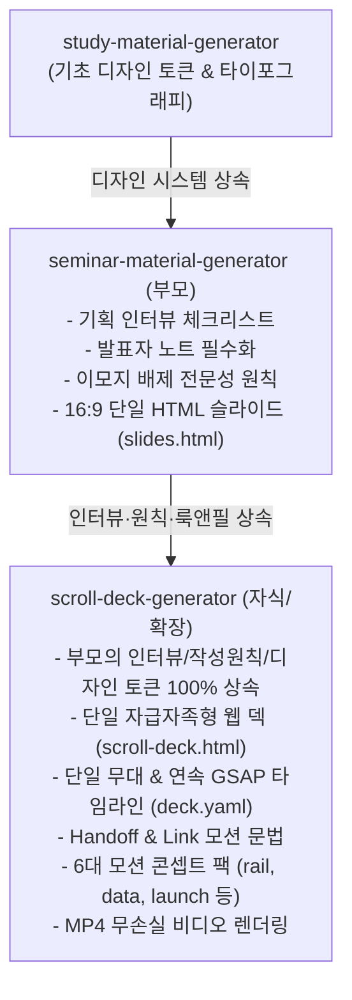

# scroll-deck-generator

`seminar-material-generator`의 기획 인터뷰와 디자인 시스템을 상속받아, 슬라이드 컷 없이 사물이 변신하며 이어지는 **스크롤 구동형 프레젠테이션 덱(Scrolline v2)** 및 **MP4 고화질 비디오**를 생성하는 에이전트 스킬입니다.

---

## 1. 개요 및 상속 관계 (Inheritance & Concept)



### 왜 확장 스킬인가?
- **부모 스킬 (`seminar-material-generator`)**: 이산적(Discrete) 슬라이드 넘김 방식, 발표자 모드(`P` 키), 정독용 Docs 핸드아웃 모드(`D` 키), 단일 HTML 자급자족(`slides.html`), A4/16:9 PDF 인쇄 최적화.
- **자식 스킬 (`scroll-deck-generator`)**:
  - **단일 자급자족형 웹 덱 (`scroll-deck.html`)**: 부모의 **다크/라이트 테마 전환(`T` 키)**, **화면 암전(`B` 키)**, **단축키 안내 모달(`?` 키)**, **발표자 스크립트 오버레이(`P` 키)**, **전체화면(`F` 키)**, **Vim 키(`h`/`l`)**를 100% 상속 구현.
  - **단일 무대 연속 타임라인**: 슬라이드 경계 없이 앞 비트(Beat)의 오브젝트가 다음 비트로 변신·이동하는 **Handoff & Link 모션**, 6대 모션 문법, 마우스 휠 스크럽 조작.
  - **영상 내보내기**: `deck.yaml` 기반 HyperFrames 무손실 MP4 영상 렌더링 지원.

---

## 2. 사전 인터뷰 체크리스트 (Pre-generation Checklist)

에이전트는 덱 저작에 착수하기 전, 부모 스킬의 6대 메타데이터에 **모션 콘셉트**를 더한 총 **7대 메타데이터**를 질문하여 확정해야 합니다:

1. **보안 등급 (`classification`)** (부모 상속):
   - `CONFIDENTIAL` (붉은색 보안 경고), `INTERNAL USE ONLY` (앰버색 사내용), `PUBLIC` (녹색 공개용), 또는 `null` (미표시).
2. **발표 행사/세미나 명칭 (`event`)** (부모 상속):
   - 예: 사내 기술 교류회, Tech Summit, 신제품 키노트 등.
3. **발표자 및 소속 정보 (`presenter`)** (부모 상속):
   - 성명, 직함, 소속 조직/연구소, 발표 일시.
4. **발표 목표 시간 및 분량 (`duration`)** (부모 상속):
   - 기준: **발표 1분당 정지점(Stop) 1~2개**.
   - 10분 발표 ➔ 10~15개 정지점 / 20분 발표 ➔ 20~25개 정지점.
5. **대상 청중의 전문성 레벨 (`audience`)** (부모 상속):
   - 심층 엔지니어 / 경영진 및 의사결정자 / 범용 개발자 / 일반 대중.
6. **핵심 메시지 (Key Takeaway)** (부모 상속):
   - 청중이 프레젠테이션 종료 후 반드시 기억해야 할 결론 One-liner.
7. **모션 콘셉트 팩 (`concept`)** (확장 특화):
   - 발표 주제의 이야기 구조에 맞게 아래 6대 콘셉트 중 하나를 확정합니다.

### 6대 모션 콘셉트 팩 선택 기준
| 이야기 구조 | 콘셉트 | 실무 적용 시나리오 | 시그니처 무브 (Signature Moves) |
|---|---|---|---|
| 시간 순서로 사건이 전개됨 | **`rail`** | 회사 연혁, 기술 로드맵, 산업 10년사 | `rail-advance`, `era-shift`, `counter-handoff` |
| 수치와 차트가 변하며 주장을 입증함 | **`data`** | 분기 실적 보고, 시장 점유율, 통계 분석 | `dot-multiply`, `mark-morph`, `annotation-pin` |
| 단일 제품/솔루션을 임팩트 있게 공개 | **`launch`** | 신제품 발표, 핵심 기능 릴리즈 쇼케이스 | `lit-from-dark`, `sticky-scrub-link`, `number-slam` |
| 거시적 전체에서 핵심 원인으로 파고듦 | **`zoom`** | 장애 원인 진단, TAM-SAM-SOM, 계층 구조 | `zoom-dive`, `zoom-surface`, `depth-ladder` |
| 2.5D 지도 위를 카메라가 비행하며 순회 | **`canvas`** | 시드 투자 피치덱, 전략 지도, 워크플로 | `arc-flight`, `establish-crane`, `atlas-pullback` |
| 문장과 키워드가 무대를 압도함 | **`kinetic`** | 컨퍼런스 키노트, 비전 선언, 개념 강의 | `word-door`, `slot-pick`, `phrase-fold` |

---

## 3. 콘텐츠 저작 규범 (Authoring Rules)

부모 스킬의 철학을 엄격히 계승하여 신뢰성과 품격을 유지합니다:

1. **내용은 Beat, 움직임은 Move**:
   - `deck.yaml`에는 오직 발표 내용과 Move 이름/파라미터만 선언합니다. 엔진 코드를 개별 덱을 위해 임의 수정하지 않습니다.
2. **1정지점 = 1주장 (Scannability)**:
   - 정지점마다 청중의 시선 초점은 1개로 제한합니다.
   - 글자 위계는 3단(결론 ➔ 보충 ➔ 출처) 이내로 제한하며 불릿은 3~4개 이하로 간결화합니다.
3. **전문성 타이포그래피 및 이모지(Emoji) 엄격 배제**:
   - 본문 텍스트, 타이틀, 뱃지, 도표 전반에서 이모지를 일체 사용하지 않습니다.
   - 정갈한 CSS 뱃지, 모노스페이스 코드 폰트, 볼드 타이포그래피로 구조화합니다.
4. **수치 날조 금지 및 출처 명시**:
   - 실데이터 덱(`sample: false`)은 모든 숫자, 차트, 인용문마다 `source` 필드를 필수로 명시하고 상단 `sources[]`에 URL과 확인일을 기재합니다.
   - 가상 시나리오인 경우 반드시 `sample: true`를 선언하여 화면에 「표본」 배지가 노출되도록 합니다.
5. **컷(Cut) 대신 인계(Handoff)**:
   - 이어지는 두 Beat가 같은 대상(숫자, 막대, 핵심 키워드)을 다루면 `link` 무브로 이어줍니다.
   - B의 요소가 A로부터 인계받아 그려질 경우 B의 `enter`는 생략하거나 `engine:none`으로 처리합니다.
6. **발표자 노트 (Speaker Notes) 필수화**:
   - 각 Beat 또는 Step의 `notes` 필드에 실제 발표 시 청중에게 건네는 **구어체 스피치 스크립트**와 **강조 포인트**를 작성합니다.
7. **3D는 카메라로만 구현**:
   - 불필요한 3D 오브젝트나 와이어프레임을 렌더링하지 않으며, 깊이감과 원근감은 오직 `.sl-camera`와 `data-depth` 레이어 심도로만 연출합니다.

---

## 4. `deck.yaml` 구조 가이드

`deck.yaml`의 표준 선언 구조 예시입니다:

```yaml
id: tech-roadmap-2026
title: "차세대 분산 아키텍처 전환 로드맵"
concept: rail               # rail | data | launch | zoom | canvas | kinetic
sample: false              # 실데이터: false, 가상 표본: true
classification: "INTERNAL USE ONLY"
event: "2026 테크 아키텍처 워크숍"
presenter:
  name: "홍길동 수석 엔지니어"
  org: "플랫폼 인프라 아키텍처팀"
sources:
  - id: s-bench
    title: "사내 IPC 벤치마크 리포트 (2026 Q1)"
    url: "https://internal.wiki/benchmark-2026"

beats:
  - id: b-intro
    type: statement
    title: "기존 모놀리스 IPC의 한계"
    subtitle: "초당 10만 건 이상의 트래픽에서 병목 발생"
    place: { slot: full }
    notes:
      script: "여러분 안녕하세요. 오늘 말씀드릴 주제는 분산 환경에서의 IPC 최적화입니다. 화면의 수치에서 보시듯..."

  - id: b-benchmark
    type: chart
    kind: bar
    categories: ["gRPC", "WebRTC DataChannel", "Zenoh"]
    series:
      - name: "P99 레이턴시 (ms)"
        values: [14.2, 8.5, 2.1]
    title: "Zenoh 기반 레이턴시 85% 감축"
    source: s-bench
    place: { slot: full }
    steps:
      - name: highlight-zenoh
        move: annotation-pin
        notes:
          script: "특히 세 번째 Zenoh 프로토콜의 P99 지연 시간 수치에 주목해 주십시오."
```

---

## 5. 실행 워크플로우 (Execution Workflow)

1. **브리프 인터뷰 및 메타데이터 확정**:
   - 7대 사전 체크리스트를 질문하여 확정합니다.
2. **콘셉트 및 Beat 테이블 기획**:
   - 사용자에게 확정된 콘셉트와 Beat 목록(ID, 유형, 핵심 메시지, 정지점 수)을 표로 제시하고 승인을 받습니다.
3. **`deck.yaml` 파일 저작**:
   - `skills/scroll-deck-generator/assets/deck-template.yaml`을 기반으로 해당 프로젝트 디렉터리(예: `decks/<id>/deck.yaml` 또는 `output/<id>/deck.yaml`)에 작성합니다.
4. **타이밍 및 정지점 검증 (`plan`)**:
   ```bash
   python skills/scroll-deck-generator/scripts/validate-deck.py decks/<id>/deck.yaml
   ```
   *(Scrolline 환경 연동 시: `npm run deck -- plan <id>`)*
5. **브라우저 프리뷰 및 상호작용 검증**:
   - 브라우저에서 휠 스크럽 및 방향키 정지점 이동 확인.
6. **MP4 고화질 비디오 내보내기 (선택)**:
   - HyperFrames CLI를 통해 고화질 비디오 렌더링 (`npm run export -- <id>`).

---

## 6. 부모 스킬과의 선택 가이드 (Routing Guide)

- **`seminar-material-generator` 선택 시**:
  - 단일 독립 HTML 파일(`slides.html`)로 간편하게 공유/배포해야 할 때
  - 듀얼 모니터 발표자 모드(`P` 키) 및 청중 전달용 기술 백서 모드(`D` 키)가 필요할 때
  - 종이 출력 및 A4/16:9 PDF 인쇄 최적화가 필수적일 때
- **`scroll-deck-generator` 선택 시**:
  - 제품 런치, 비전 선언, 기술 로드맵 등 시각적 몰입감과 모션이 매우 중요할 때
  - 휠 스크롤에 반응하며 요소가 자연스럽게 변신(Handoff)하는 Scrollytelling이 필요할 때
  - 프레젠테이션 전체를 고화질 동영상(MP4)으로 렌더링하여 유튜브나 사내 영상 보관소에 올려야 할 때
